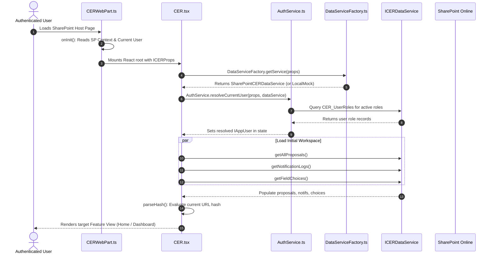

# CER Management System — Application Flow & Architecture

## 1. Application Lifecycle & Startup Sequence

When a user loads the SharePoint page hosting the CER web part, execution flows systematically through the following phases:

---

## 2. Navigation & Deep Linking Architecture

The application implements client-side URL hash routing (`#view/proposalId`), enabling:
- Direct bookmarking and email link routing (e.g., `#display/CER-2026-0042` or `#pending-approvals`).
- Full browser History stack integration (Back and Forward buttons work seamlessly).
- Natural vertical scrolling and auto-scroll reset on route changes.

### Route Mapping Matrix

| URL Hash | Target View Component | Required Permission / Access |
|---|---|---|
| `#dashboard` | `Home/HomeView.tsx` | All authenticated users |
| `#create` | `CreateCER/CreateCERView.tsx` | Initiator or Admin role |
| `#change/{cerprno}` | `ChangeCER/ChangeCERView.tsx` | Proposal Owner, Initiator, or Admin |
| `#display/{cerprno}` | `DisplayCER/DisplayCERView.tsx` | All authenticated users |
| `#my-proposals` | `MyProposals/ProposalListView.tsx` (mode="my") | All authenticated users |
| `#all-proposals` | `MyProposals/ProposalListView.tsx` (mode="all") | All authenticated users |
| `#pending-approvals` | `PendingApprovals/PendingApprovalsView.tsx` | Approver or Admin role |
| `#approval-history` | `ApprovalWorkflow/ApprovalHistoryView.tsx` | All authenticated users |
| `#reports` | `Reports/ReportsView.tsx` | Finance, Audit, or Admin role |
| `#audit-trail` | `Audit/AuditTrailView.tsx` | All authenticated users |
| `#workflow-config` | `Admin/AdminConsoleView.tsx` | System Administrator only |

---

## 3. Data Flow Architecture

### Creating a CER Proposal
1. **User input**: User fills out multi-section wizard (`ProjectDetails`, `CostBreakdown`, `Phasing`, `BudgetJV`, `Remarks`).
2. **Validation**: Client validates required fields, email syntax, word counts, and financial balances via `cerValidation.ts`.
3. **Numbering**: Service generates unique proposal number format: `CER/{SBU}/{FY}/{Sequence}` (e.g. `CER/RJN/26-27/0014`).
4. **Initial Stage Routing**: Looks up SBU-specific workflow in `CER_Workflow_Config`. If Level 1 is flagged as `is_project_owner_stage`, assigns `pending_with_email` dynamically from the entered `owner_email`.
5. **Persistence**:
   - Creates item in `CER_Master`.
   - Creates line items in `CER_CostBreakdown` and `CER_Phasing`.
   - Uploads documents to `CER_Documents` library with proposal ID metadata.
   - Logs creation event in `CER_Audit_Log`.
   - Emits email notification log in `CER_Notification_Log`.

### Approving a CER Proposal
1. **Inbox Retrieval**: Approver visits `#pending-approvals`. System filters proposals where `status === 'In Approval'` and `pending_with_email === currentUser.email` (or user is Admin).
2. **Segregation of Duties Check**: System verifies `currentUser.email !== proposal.initiator_email` to prevent self-approval.
3. **Decision Execution**:
   - User enters mandatory decision remarks and clicks **Approve**, **Reject**, or **Revert**.
   - Service records decision in `CER_Workflow_History`.
   - If **Approved**: If intermediate level, advances proposal to `next_level` and assigns next approver from SBU configuration. If final level, marks proposal `Approved`.
   - If **Rejected**: Marks proposal `Rejected` (terminal state).
   - If **Reverted**: Resets status to `Draft` / `Reverted`, returns proposal to Initiator for edits.
   - Updates `CER_Master`.
   - Sends notification to creator, previous approvers, and next approver.
