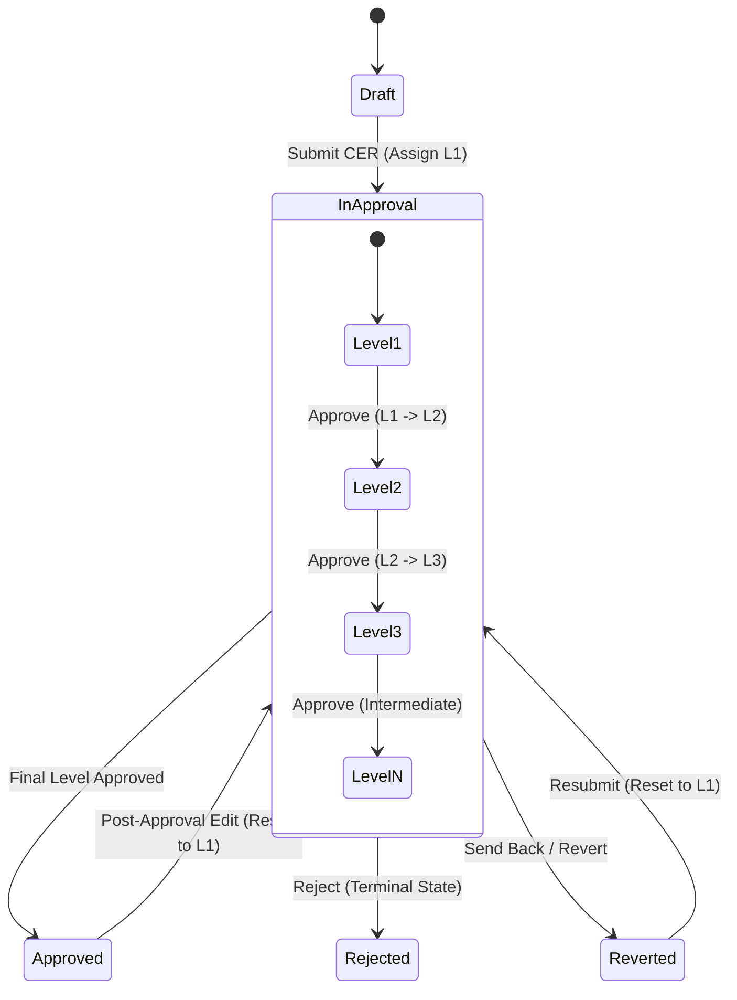

# CER Management System — Approval Workflow Engine

## 1. Overview

The CER Management System implements a multi-tier governance matrix that combines sequential approval progression with Strategic Business Unit (SBU) specific routing and dynamic approver resolution.

---

## 2. Standard 7-Level Approval Hierarchy

The system defines 7 canonical approval stages:

| Level | Role / Stage Name | Business Function | Primary Validation Focus |
|---|---|---|---|
| **Level 1** | Head of Department (HOD) / Project Owner | Technical & Operational Need | Justification, equipment specifications, project scope |
| **Level 2** | Finance & Accounts (F&A) | Financial Sanity & Accounting | Capex vs Opex classification, tax impact, budget availability |
| **Level 3** | SBU Head | Strategic Business Alignment | SBU operational goals, field development synergy |
| **Level 4** | Executive Committee (ExCo) | Corporate Governance | Major capital allocation review, inter-departmental priorities |
| **Level 5** | Chief Financial Officer (CFO) | Fiscal Risk & Liquidity | Treasury impact, financing terms, corporate budget clearance |
| **Level 6** | Chief Executive Officer (CEO) | Executive Authorization | Enterprise alignment, risk appetite, ROI thresholds |
| **Level 7** | Board of Directors | Ultimate Statutory Governance | Massive capital outlays exceeding statutory threshold limits |

---

## 3. SBU-Specific Sequential Routing

Rather than forcing every SBU into an inflexible 7-step process, the system allows each SBU to define its exact number of stages:

- **RJ North**: Configured with 3 active sequential levels:
  - Stage 1: Project Owner (Dynamic Auto-Assignment)
  - Stage 2: Discipline Lead / Technical Manager
  - Stage 3: SBU Head
- **RJ South**: Configured with 2 active levels.
- **CBOS**: Configured with 4 active levels.
- **RAVA**: Configured with 1 active level.

### Contiguous Sequence Guarantee
When administrators insert or reorder stages in `Admin/ApprovalHierarchyTab.tsx`, the system automatically re-sequences stages to ensure contiguous numbering (`1, 2, 3...`) without gaps or duplicates.

---

## 4. Dynamic Approver Assignment: Project Owner Auto-Fetch

### The Problem Solved
In traditional workflows, creators had to manually look up and select who should approve Level 1. This caused routing mistakes, delayed approvals, and human error.

### The Mechanism
1. **Assignment Type Field**:
   Each stage in `CER_Workflow_Config` has an `assignment_type` property:
   - `Specific User`: Approver is bound to a specific designated email address.
   - `Auto — Project Owner` (`ProjectOwnerAuto`): Approver is dynamically derived from the proposal itself.
2. **Dynamic Auto-Fetch at Creation**:
   When a proposal is submitted, the system checks whether Level 1 is marked `is_project_owner_stage`. If true:
   ```ts
   // Extracted from DataService workflow initialization:
   if (firstLevel.is_project_owner_stage || firstLevel.assignment_type === 'ProjectOwnerAuto') {
     proposal.pending_with_email = proposal.owner_email;
     proposal.pending_with_name = proposal.owname;
     proposal.pending_with_role = "Project Owner";
   }
   ```
3. **Independent Resolution**:
   Proposal A (Owner: Alice) routes to Alice. Proposal B (Owner: Bob) routes to Bob. No hardcoded emails exist in the configuration.

---

## 5. Security & Governance Policies

### A. Segregation of Duties (SoD)
To comply with financial audit standards:
- The proposal initiator/creator is **strictly barred** from approving their own request at any stage.
- If an initiator attempts to approve, `PermissionService.canApproveAtCurrentLevel` returns `false`, and the service layer throws:
  `"Segregation of duties: Initiator cannot approve their own proposal."`

### B. Post-Approval Re-trigger Mechanics
If an already approved or in-flight proposal is modified:
- Status reverts immediately to `In Approval`.
- Current workflow stage resets to **Level 1**.
- All subsequent approvers must re-evaluate the modified proposal.
- Previous approval history entries are permanently preserved for audit visibility.

### C. Approval Decision Actions



1. **Approve**: Records approval decision, appends user remarks, and advances proposal to `current_level + 1`. If the current level is the highest configured level for that SBU, status transitions to `Approved`.
2. **Reject**: Workflow terminates immediately. Proposal status transitions to `Rejected`. No further modifications are permitted.
3. **Send Back / Revert**: Proposal status transitions to `Reverted`. The proposal is returned to the Initiator to make required amendments. When resubmitted, it restarts at Level 1 to guarantee full re-validation.
