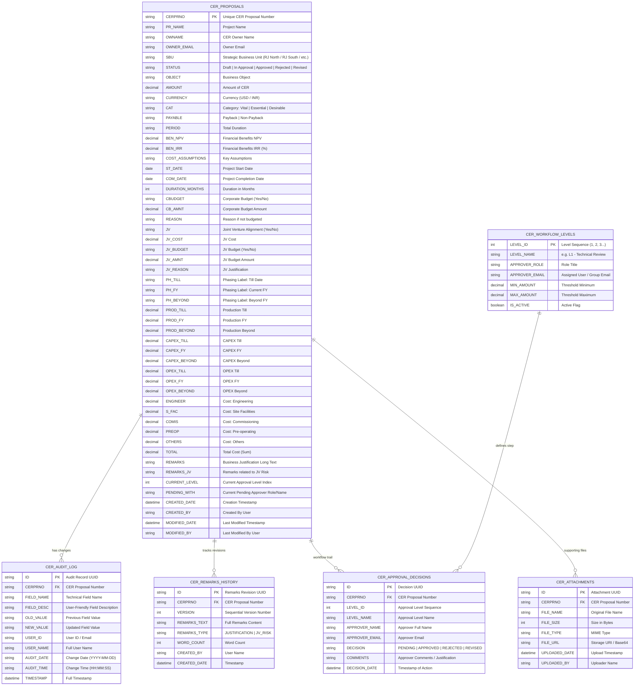

# Capital Expenditure Request Management System (CER)
## Database & Entity Schema Design

This document details the normalized relational data model and corresponding SharePoint Online list schemas for the CER Management System.

---

### 1. Entity Relationship Model Overview

---

### 2. Field Audit Mapping Dictionary

When logging changes (FR-06), short technical field names are mapped to user-friendly business labels:

| Field Name | User-Friendly Business Label | Exclusion Flag |
| :--- | :--- | :--- |
| `REMARKS` | "Remarks (including Justification for Non Payback expenditure, etc)" | Logged (Special Diff) |
| `REMARKS_JV` | "Remarks related to Joint Venture (JV) Risk" | Logged (Special Diff) |
| `PROD_TILL` | "Production Expenditure — Till Specified Period" | Logged |
| `PROD_FY` | "Production Expenditure — Current FY Period" | Logged |
| `PROD_BEYOND` | "Production Expenditure — Beyond FY Period" | Logged |
| `CAPEX_TILL` | "CAPEX Expenditure — Till Specified Period" | Logged |
| `CAPEX_FY` | "CAPEX Expenditure — Current FY Period" | Logged |
| `CAPEX_BEYOND`| "CAPEX Expenditure — Beyond FY Period" | Logged |
| `OPEX_TILL` | "OPEX Expenditure — Till Specified Period" | Logged |
| `OPEX_FY` | "OPEX Expenditure — Current FY Period" | Logged |
| `OPEX_BEYOND` | "OPEX Expenditure — Beyond FY Period" | Logged |
| `ENGINEER` | "Cost Breakdown — Engineering" | Logged |
| `S_FAC` | "Cost Breakdown — Site Facilities" | Logged |
| `COMIS` | "Cost Breakdown — Commissioning" | Logged |
| `PREOP` | "Cost Breakdown — Pre-operating Costs" | Logged |
| `OTHERS` | "Cost Breakdown — Others" | Logged |
| `TOTAL` | "Total Estimated Expenditure" | Logged |
| `BEN_NPV` | "Financial Benefits — Net Present Value (NPV)" | Logged |
| `BEN_IRR` | "Financial Benefits — Internal Rate of Return (IRR %)" | Logged |
| `AMOUNT` | "Amount of CER" | Logged |
| `CAT` | "Proposal Category" | Logged |
| `PAYABLE` | "Payback / Non-Payback" | Logged |
| `CBUDGET` | "Corporate Budget Status" | Logged |
| `JV` | "Joint Venture (JV) Alignment" | Logged |
| `CREATED_DATE`| System Creation Date | **EXCLUDED** (Technical) |
| `CREATED_BY` | System Creation User | **EXCLUDED** (Technical) |
| `MODIFIED_DATE`| System Modification Date | **EXCLUDED** (Technical) |
| `USRID` | Technical User Identifier | **EXCLUDED** (Technical) |
| `CHANGE_IND` | Change Indicator Flag | **EXCLUDED** (Technical) |
| `APPROVE` | Internal Approval Flag | **EXCLUDED** (Technical) |
