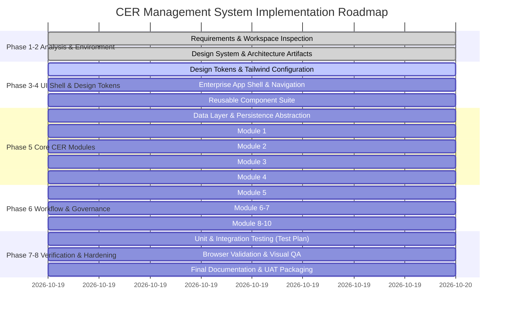

# Capital Expenditure Request Management System (CER)
## Implementation Plan & Roadmap

### 1. Executive Implementation Strategy

The implementation is structured into sequential, verifiable stages to ensure high business correctness, visual excellence, robust role-based security, and full coverage of the source document requirements.

---

### 2. Phased Milestone Breakdown

---

### 3. Detailed Work Breakdown Structure (WBS)

#### Stage 1: Design Tokens & Component Library
- [x] Configure Tailwind CSS with enterprise color palettes and font styling.
- [x] Build atomic components: Button, Input, Select, TextArea, Badge, Card, Modal, Tooltip, Alert.
- [x] Build composite components: `FormSection`, `WordCounter`, `DataTable`, `BreadcrumbNav`, `NotificationCenter`.

#### Stage 2: Data Models & Service Abstraction Layer
- [x] Define TypeScript interfaces for CER Proposals, Audit Logs, Remarks History, Workflow Levels, and Attachments.
- [x] Implement `ICERDataService` interface.
- [x] Implement `LocalMockCERDataService` pre-loaded with realistic Cairn/Vedanta projects (e.g. Mangala Polymer Expansion, Aishwariya Infill Drilling, Raageshwari Gas Terminal Upgrade).
- [x] Implement SharePoint REST API connector ready for production deployment.

#### Stage 3: Core Navigation Shell & Dashboard (Phase 3 & 9)
- [x] Enterprise sidebar with collapsible state and active indicator.
- [x] Top navigation bar with user profile, role switcher (Initiator, Approver, Finance/Audit, Admin), quick notification badge.
- [x] Executive Dashboard featuring real aggregated KPI cards, expenditure breakdown, proposal status donut, and "Awaiting My Action" queue.

#### Stage 4: Module 1 — Create CER (FR-01)
- [x] Sections: Project Details, Financial Benefits (NPV/IRR/Payback), Corporate Budget, JV Details, Phasing Matrix, Cost Breakdown, Remarks, and Attachments.
- [x] Real-time calculations: Total duration in months, total cost summation, cost vs budget check.
- [x] Word counter for Remarks (350–400 words limitation warning).
- [x] Concurrency-safe unique proposal number generator (`CER-YYYY-XXXX`).
- [x] SBU updates: RJ North and RJ South; removal of RJ01.
- [x] Category dropdown with Vital, Essential, Desirable and definition guide.
- [x] Save & Submit to Approval Workflow with success feedback.

#### Stage 5: Module 2 — Change CER (FR-02)
- [x] Proposal number lookup with mandatory field validation.
- [x] Field-level delta comparator to detect only altered fields.
- [x] Remarks versioning (only saves when text changes).
- [x] Workflow re-triggering and notification simulation.

#### Stage 6: Module 3 — Display CER (FR-03)
- [x] Complete structured view of proposal.
- [x] Prominent pending approval level indicator.
- [x] Visual approval progress stepper.
- [x] Attached files list with preview/download.
- [x] Action bar: Edit, PDF Download, Excel Export, Print.

#### Stage 7: Module 4 — Reports & Analytics (FR-04)
- [x] Advanced search and filter panel (Proposal ID, Name, Category, Status, SBU, Date Range).
- [x] Interactive data grid with sorting, pagination, and multi-row selection.
- [x] Quick export to Excel functionality.

#### Stage 8: Module 5 — Configurable Approval Workflow (FR-05)
- [x] Pending approvals queue for current approver.
- [x] Detailed review modal with full CER summary and attachments visibility.
- [x] Approve and Reject actions with required comments.
- [x] Email notification simulator marking Creator, Previous Approvers, and Next Approver.
- [x] Workflow Configuration UI allowing admin to add/remove/reorder approval levels.

#### Stage 9: Module 6 & 7 — Audit Trail & Remarks History (FR-06, FR-07, FR-08)
- [x] Audit Trail explorer searchable by proposal number.
- [x] Exclusion of technical fields (`CREATED_DATE`, `USRID`, etc.).
- [x] Modal for inspecting before/after diff of long remarks text.
- [x] Historical version browser for remarks.

#### Stage 10: Module 8, 9 & 10 — Documents & Attachments (FR-09, FR-10)
- [x] Professional vector PDF export with headers, financial breakdown, and signature trail.
- [x] Safe Excel export with business column headers and CSV formula sanitization.
- [x] Multi-file attachment uploader supporting PDF, DOCX, XLSX, PNG, JPG with file size and type validation.

#### Stage 11: Testing & Quality Assurance
- [x] Automated unit and integration tests covering calculations, validations, workflow transitions, and audit generation.
- [x] Browser automated verification using subagents.
- [x] Linting and type-checking verification.
