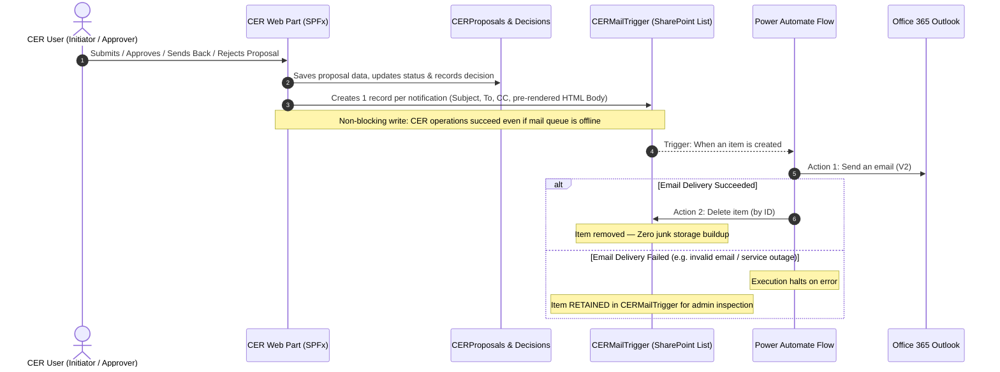

# CER Management System — Power Automate Email Notifications Guide (Outbox Architecture)

**Target Environment:** SharePoint Online UAT & Production (`https://vedanta.sharepoint.com/sites/CERManagementSystemUAT`)  
**Architecture:** Single Dedicated Outbox Queue List (`CERMailTrigger`)  
**Power Automate Setup:** Exactly **ONE** automated cloud flow with **3 actions**  
**Version:** 4.0 (Outbox Pattern with Individual Success Deletion & Failure Retention)

---

## 1. System Architecture & How It Works

The CER Management System utilizes an **Outbox Pattern** to decouple SharePoint list business operations from email delivery:

---

## 2. Notification Catalog & Routing Matrix

All 6 notification scenarios are pre-rendered directly by the SPFx application (`EmailTemplateService`) and sent to `CERMailTrigger` as individual records:

| # | Notification Scenario | Triggering Workflow Event | Primary Recipient (`recipientEmails`) | CC (`ccEmails`) | Subject Template | Importance |
| :- | :--- | :--- | :--- | :--- | :--- | :--- |
| **1a** | **New Proposal Submission** | Initiator clicks **Submit** on new CER | **Level 1 Approver(s)** (all assigned users) | _None_ | `[CER Action Required] Proposal {cerPrId} Pending Level 1 ({role}) Review` | `High` |
| **1b** | **Submission Confirmation** | Initiator clicks **Submit** on new CER | **CER Owner** (`owner_email`) | _None_ | `[CER Submission] Proposal {cerPrId} Submitted for Approval` | `Normal` |
| **2a** | **Resubmission (Post Send Back)** | Initiator clicks **Submit** after rework | **Level 1 Approver(s)** (all assigned users) | _None_ | `[CER Action Required] Proposal {cerPrId} Pending Level 1 ({role}) Review` | `High` |
| **2b** | **Resubmission Confirmation** | Initiator clicks **Submit** after rework | **CER Owner** (`owner_email`) | _None_ | `[CER Submission] Proposal {cerPrId} Submitted for Approval` | `Normal` |
| **3a** | **Stage Advancement** | Approver clicks **Approve** (Levels 1–5) | **Next Level Approver(s)** (all assigned users) | _None_ | `[CER Action Required] Proposal {cerPrId} Pending Level {nextLevel} ({role}) Review` | `High` |
| **3b** | **Progress Update** | Approver clicks **Approve** (Levels 1–5) | **CER Owner** (`owner_email`) | _None_ | `[CER Update] Proposal {cerPrId} Approved at Level {levelId}` | `Normal` |
| **4** | **Final Executive Sanction** | Approver clicks **Approve** (Level 6) | **CER Owner** (`owner_email`) | **Final Approver** | `[CER Final Sanction] Proposal {cerPrId} Approved` | `High` |
| **5** | **Send Back (Rework Requested)** | Approver clicks **Send Back** | **CER Owner** (`owner_email`) | **Deciding Approver** | `[CER Revision Requested] Proposal {cerPrId} Sent Back by Level {levelId}` | `High` |
| **6** | **Proposal Rejection** | Approver clicks **Reject** | **CER Owner** (`owner_email`) | **Deciding Approver** | `[CER Rejected] Proposal {cerPrId} Rejected at Level {levelId}` | `High` |

---

## 3. SharePoint List Specification: `CERMailTrigger`

The list is created in your SharePoint site collection:  
**URL:** `https://vedanta.sharepoint.com/sites/CERManagementSystemUAT`  
**List Name:** `CERMailTrigger`

### Column Definitions

| # | Display Name | Internal Name | SharePoint Field Type | Required? | Constraints & Details |
|---|---|---|---|---|---|
| **1** | **Title** | `Title` | Single line of text (Built-in) | **Yes** | Stores `cerPrId - Scenario` (e.g. `CER-2026-0001 - Submission`) |
| **2** | **CER Proposal ID** | `cerPrId` | Single line of text | No | Permanent Proposal ID (`CER-YYYY-NNNN`) |
| **3** | **Scenario** | `scenario` | Single line of text | No | `Submission`, `Resubmission`, `StageAdvancement`, `FinalSanction`, `SendBack`, `Rejected` |
| **4** | **Recipient Emails** | `recipientEmails` | Multiple lines of text | No | Plain text. Semicolon-delimited `To` addresses |
| **5** | **CC Emails** | `ccEmails` | Multiple lines of text | No | Plain text. Semicolon-delimited `CC` addresses |
| **6** | **Email Subject** | `emailSubject` | Single line of text | No | Complete subject line |
| **7** | **Email Body** | `emailBody` | Multiple lines of text | No | Plain text (unlimited). Pre-rendered branded HTML |
| **8** | **Importance** | `importance` | Single line of text | No | `High` or `Normal` |

> [!NOTE]
> All custom columns use plain text and have **"Require that this column contains information: No"**. This eliminates any possibility of `ResponseSwaggerSchemaValidationFailure` in Power Automate.

---

## 4. Power Automate Step-by-Step Setup Guide

You will create **only ONE automated cloud flow** in [make.powerautomate.com](https://make.powerautomate.com).

### Step 4.1: Create the Flow
1. Go to [make.powerautomate.com](https://make.powerautomate.com).
2. Click **+ Create** in the left sidebar $\rightarrow$ choose **Automated cloud flow**.
3. **Flow name:** `CER - Unified Email Dispatcher`.
4. Under "Choose your flow's trigger", search for: **When an item is created** (SharePoint).
5. Select it and click **Create**.

---

### Step 4.2: Configure Trigger — `When an item is created`
In the trigger card:
* **Site Address:** Select or paste: `https://vedanta.sharepoint.com/sites/CERManagementSystemUAT`
* **List Name:** Select: `CERMailTrigger`

---

### Step 4.3: Add Action 1 — `Send an email (V2)`
1. Click **+ New step** (or **+ Add an action**).
2. Search for: `Send an email (V2)`.
3. Select the **Office 365 Outlook** connector.
4. Map the fields using **Dynamic Content** from the trigger:

| Field | Dynamic Content Selection | Notes |
|---|---|---|
| **To** | **`recipientEmails`** | Contains single or semicolon-separated approver emails |
| **Subject** | **`emailSubject`** | Formatted subject line |
| **Body** | **`emailBody`** | Pre-rendered responsive HTML body |
| **CC** | **`ccEmails`** | Click _Show advanced options_ to reveal |
| **Importance** | **`importance`** | Click _Show advanced options_ $\rightarrow$ select `importance` (or leave default) |
| **Is HTML** | `Yes` | Default is Yes |

---

### Step 4.4: Add Action 2 — `Delete item` (Individual Success Deletion)
1. Click **+ New step** (or **+ Add an action**) directly beneath the `Send an email (V2)` card.
2. Search for: `Delete item`.
3. Select the **SharePoint** connector.
4. Configure:

| Field | Value |
|---|---|
| **Site Address** | `https://vedanta.sharepoint.com/sites/CERManagementSystemUAT` |
| **List Name** | `CERMailTrigger` |
| **Id** | In Dynamic Content under the trigger, select: **`ID`** |

5. Click **Save** in the top-right corner.

**Your flow is now completely configured!**

---

## 5. Architectural Safeguards & Reliability

### 1. Automatic Failure Retention
* In Power Automate, actions run sequentially by default with the execution rule `run after: is successful`.
* **If `Send an email (V2)` succeeds:** Action 2 (`Delete item`) executes and removes the processed record. `CERMailTrigger` remains clean with near-zero items.
* **If `Send an email (V2)` fails:** Action 2 **never runs**. The item is retained in `CERMailTrigger` with its full error state, allowing administrators to review the recipient address or investigate Exchange deliverability issues.

### 2. Zero Storage Footprint
* Because successfully delivered records are deleted immediately by ID, the list does not accumulate thousands of redundant rows.
* You do not need to configure periodic scheduled deletion flows or bulk cleanup scripts.
* Power Automate automatically maintains a detailed **28-day Run History** showing exact input parameters, output statuses, timestamps, and error codes for every execution.

### 3. Non-Blocking Client Execution
* In the SPFx web part, queueing an item to `CERMailTrigger` is wrapped in a dedicated `try...catch` block.
* If SharePoint encounters a transient network glitch while writing to `CERMailTrigger`, the proposal creation, approval decision, or status update **still succeeds and is not rolled back**. A warning is logged to the developer console.

### 4. Direct Deep Links & Portal Links
Every email generated by `EmailTemplateService` contains:
* **Direct Deep-Link Action Button:** Navigates directly to `#display/{cerPrId}` (for review/approvals) or `#change/{cerPrId}` (for rework editing).
* **Enterprise Portal Banner:** Contains a direct link to the CER Management System home page (`https://vedanta.sharepoint.com/sites/CERManagementSystemUAT`).
* **Vedanta Navy Branding:** Standard corporate header (`#012964`) and responsive card container.

---

## 6. End-to-End Testing & Verification

Follow these steps to test the email notification pipeline:

1. **Ensure the Flow Is Turned On:**
   In [make.powerautomate.com](https://make.powerautomate.com) $\rightarrow$ **My flows** $\rightarrow$ verify `CER - Unified Email Dispatcher` status is **On**.
2. **Submit a New Test Proposal:**
   - Open the CER portal: `https://vedanta.sharepoint.com/sites/CERManagementSystemUAT/SitePages/CER.aspx`.
   - Create and submit a proposal.
3. **Verify Queue Execution:**
   - Open the `CERMailTrigger` list in SharePoint: you will see two items created briefly (`Submission` for L1 Approvers, and `Submission_Confirmation` for the Owner).
   - Within 5–15 seconds, Power Automate picks them up, delivers the emails, and deletes both items.
   - Refresh the `CERMailTrigger` list: count should return to **0**.
4. **Verify Outlook Inboxes:**
   - Level 1 Approvers receive the **[CER Action Required]** email with project details and the "Review & Approve in CER Portal" button.
   - Proposal Owner receives the **[CER Submission]** confirmation email.
5. **Test Stage Approval:**
   - Log in as the assigned Level 1 Approver $\rightarrow$ click **Approve**.
   - Verify Level 2 Approver receives the **[CER Action Required]** email (including Level 1 approver remarks in the quote box).
   - Proposal Owner receives the **[CER Update]** progress notification.
   - `CERMailTrigger` list remains clean at **0 items**.
