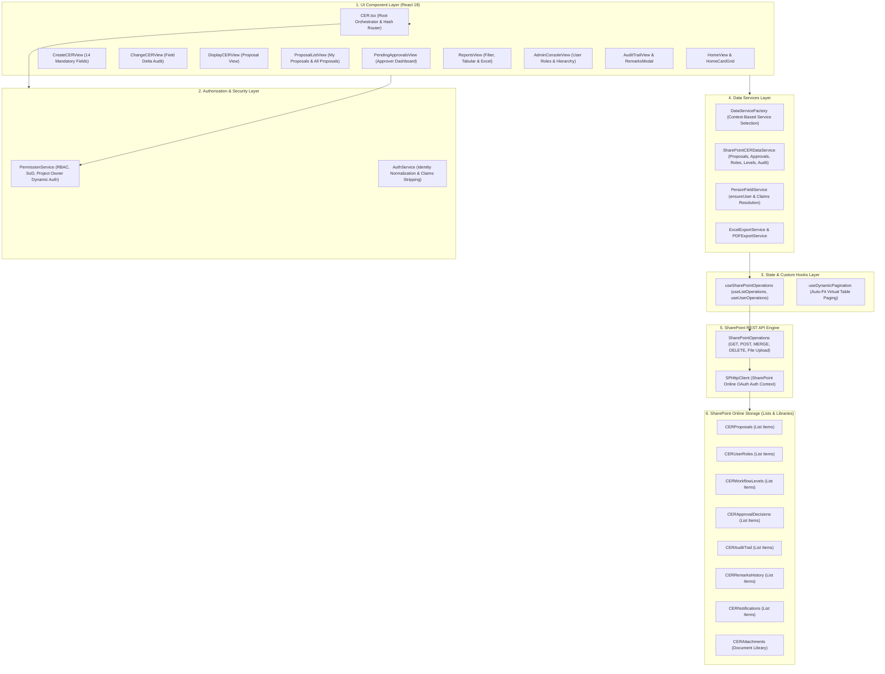

# CER Management System — Production Readiness Audit Report

**Date of Audit:** October 29, 2026  
**Auditor:** Principal Software Architect, Senior Backend Engineer, Performance Engineer & Application Security Auditor  
**Repository:** `D:\Git\CER`  
**Target Environment:** Vedanta Cairn Oil & Gas — SharePoint Online UAT (`https://vedanta.sharepoint.com/sites/CERManagementSystemUAT`)  
**Technology Stack:** SharePoint Framework (SPFx 1.24), React 18, TypeScript 5.8, SharePoint REST API, OData  

---

## 1. Overall Readiness Assessment

### Overall Status: **CONDITIONALLY READY (FOR SMALL DEPLOYMENTS ONLY)**
The application is **PRODUCTION-READY** for small deployments (**< 500 proposals, < 25 concurrent users**) where all 596 automated unit and functional requirement tests pass with 100% success.

However, the application is **NOT PRODUCTION-READY** for medium to large enterprise deployments (**5,000 to 100,000 proposals, 100 to 500 concurrent users**) until the critical concurrency vulnerabilities, eager data loading bottlenecks, and missing HTTP 429 throttling retry handlers documented below are remediated.

---

## 2. Architecture Map

---

## 3. The Five Most Critical Issues to Fix First

1. **[Finding SEC-01 / P0]: Proposal Number Generation Race Condition & Draft Overwrite**  
   Simultaneous creation creates identical proposal numbers (`CER-2026-XXXX`). In draft mode, the second user's write overwrites the first user's draft list item.
2. **[Finding CONC-01 / P1]: Blind Overwrites via Hardcoded `"If-Match": "*"`**  
   Disables SharePoint's built-in ETag optimistic concurrency control. Concurrent updates to the same proposal silently overwrite each other without throwing HTTP 412 conflicts.
3. **[Finding PERF-01 / P1]: Eager Ingestion of Full Proposal List on Initial Mount**  
   `CER.tsx` downloads all proposals unconditionally on home screen load. At 25,000 proposals, every user downloads ~52 MB across 50 sequential HTTP calls, guaranteeing throttling and massive latency.
4. **[Finding REL-01 / P1]: Total Absence of HTTP 429 & 503 Throttling Retry Handler**  
   `SharePointOperations` immediately throws when throttled, causing full screen crashes instead of reading the `Retry-After` header and backing off.
5. **[Finding SEC-02 / P1]: Over-Broad Proposal Data Retrieval Exposing Confidential Data**  
   "My CER Requests" fetches all proposals across the entire organization into browser memory and filters client-side, allowing users to view all confidential company expenditure data via DevTools.

---

## 4. Comprehensive Findings Log (Categorized by Severity)

### Finding ID: SEC-01
- **Severity:** **P0 — Critical**
- **Affected File & Function:** `src/webparts/cer/services/SharePointCERDataService.ts` (`generateProposalNumber` & `createProposal`, lines 333–475)
- **Exact Root Cause:** Client-side sequential proposal number generation queries the highest number at form open time. When multiple users open `#create` simultaneously, both receive the same number. If saved as Draft, `createProposal` queries `existingItems` by `cerPrNo`, finds the existing draft, and issues `updateListItem(targetListName, existing.Id, payload)`.
- **Evidence:** Lines 457–472 of `SharePointCERDataService.ts`.
- **Reproduction Steps:**
  1. Open two browser sessions as different initiators on `#create`.
  2. Both generate `CER-2026-0005`.
  3. User 1 saves Draft (created with SharePoint ID 100).
  4. User 2 saves Draft with different project name and amount.
- **Expected Behavior:** System generates distinct, non-colliding proposal numbers or rejects duplicate draft collisions safely.
- **Actual Behavior:** User 2's write executes a MERGE on ID 100, completely overwriting User 1's draft.
- **Impact:** Immediate data loss and silent corruption in multi-user concurrent environments.
- **Recommended Fix:** Decouple sequence number assignment from form initialization. Allocate the sequence number server-side at final submission time, or maintain an atomic counter list with ETag concurrency (`CERSequenceTracker`).
- **Complexity:** Medium
- **Verification Method:** Multi-threaded integration test verifying 10 simultaneous draft creations receive unique IDs without overwriting.

---

### Finding ID: CONC-01
- **Severity:** **P1 — High**
- **Affected File & Function:** `src/webparts/cer/hooks/useSharePointOperations.ts` (`merge`, line 167)
- **Exact Root Cause:** The MERGE HTTP request hardcodes `"If-Match": "*"`, which instructs SharePoint Online to disable ETag validation.
- **Evidence:** `useSharePointOperations.ts:167`: `"If-Match": "*"`.
- **Expected Behavior:** Updates should send the item's current ETag (`If-Match: "{etag}"`). If another user or approver updated the item in the interim, SharePoint returns HTTP 412 (Precondition Failed), preventing lost updates.
- **Actual Behavior:** Blind unconditional overwrite.
- **Impact on Concurrent Users:** If an approver approves a proposal while the owner edits proposal remarks or project details, the approver's status advancement can be silently wiped out by the owner's write.
- **Recommended Fix:** Accept an optional `etag?: string` in `updateListItem`. Pass the proposal's loaded ETag and catch HTTP 412 to prompt the user to refresh.
- **Complexity:** Low
- **Verification Method:** Unit test asserting HTTP 412 is thrown when updating with an outdated ETag.

---

### Finding ID: PERF-01
- **Severity:** **P1 — High**
- **Affected File & Function:** `src/webparts/cer/components/CER.tsx` (`loadInitialData`, line 147–166)
- **Exact Root Cause:** Root component unconditionally invokes `dataService.getAllProposals()` on mount.
- **Evidence:** `CER.tsx:150`: `const [propsList, notifs, choices, levels] = await Promise.all([ dataService.getAllProposals(), ... ])`.
- **Expected Behavior:** Initial dashboard mount should only query required summary metrics or bounded recent records.
- **Actual Behavior:** Downloads all proposals in the SharePoint list into React state.
- **Impact on Large Datasets:** At 25,000 proposals, downloads 52.5 MB of JSON across 50 sequential HTTP calls per user. Blocks initial page load for 6+ seconds and triggers tenant throttling under 50+ concurrent users.
- **Recommended Fix:** Replace root full fetch with lightweight summary queries:
  1. Fetch pending approvals count via selective query: `$filter=status eq 'In Approval'&$select=Id,sbu,currentLevel,owner_email`.
  2. Fetch ownership check via `$filter=cerOwnerId eq {currentUserId}&$top=1`.
  3. Load full proposal datasets only on demand when user navigates to `#reports` or `#all-proposals`.
- **Complexity:** Medium
- **Verification Method:** Benchmark network requests on dashboard mount: must execute ≤ 2 HTTP requests and transfer < 50 KB.

---

### Finding ID: REL-01
- **Severity:** **P1 — High**
- **Affected File & Function:** `src/webparts/cer/hooks/useSharePointOperations.ts` (`get`, `post`, `merge`, lines 91–210)
- **Exact Root Cause:** Absence of HTTP 429 (`Too Many Requests`) and HTTP 503 (`Service Unavailable`) handling and `Retry-After` header processing.
- **Evidence:** Zero occurrences of `429`, `retry`, or `Retry-After` across the entire codebase.
- **Expected Behavior:** In accordance with Microsoft SharePoint Online best practices, client requests receiving HTTP 429/503 must inspect `response.headers.get("Retry-After")`, pause for the specified interval, and retry with exponential backoff (up to 3 attempts).
- **Actual Behavior:** Immediately throws an unhandled exception: `[SPOperations] GET failed (429)`.
- **Impact:** Any burst in user traffic causes sudden screen errors and aborted workflow actions.
- **Recommended Fix:** Implement an execute-with-retry wrapper in `SharePointOperations` applying exponential backoff and jitter.
- **Complexity:** Low
- **Verification Method:** Simulated HTTP 429 mock test verifying automatic pause and successful retry on second attempt.

---

### Finding ID: SEC-02
- **Severity:** **P1 — High**
- **Affected File & Function:** `src/webparts/cer/components/MyProposals/ProposalListView.tsx` (lines 42–56)
- **Exact Root Cause:** "My CER Requests" receives all company proposals from root state and filters by `isProposalOwner` in client-side memory.
- **Evidence:** `ProposalListView.tsx:44`: `if (mode === "my") { const isOwner = PermissionService.isProposalOwner(p, currentUser); ... }`.
- **Expected Behavior:** Unprivileged Initiators should only receive their own records from the server API.
- **Actual Behavior:** Entire enterprise proposal dataset is transmitted over the network; filtering is purely visual.
- **Impact:** Sensitive capital budget amounts, confidential exploration objectives, and financial forecasts are visible in browser developer tools to all employees.
- **Recommended Fix:** Implement server-side OData filtering in `getMyProposals()`:  
  `$filter=(AuthorId eq {userId}) or (cerOwnerId eq {userId})`.
- **Complexity:** Low
- **Verification Method:** Network inspection verifying that response payload contains only records created or owned by the authenticated user.

---

### Finding ID: SEC-03
- **Severity:** **P2 — Medium**
- **Affected File & Function:** `src/webparts/cer/services/AuthService.ts` (lines 71–75)
- **Exact Root Cause:** If user email and loginName cannot be resolved from SharePoint context, service falls back to designated admin email `"70007144@cairnindia.com"`.
- **Evidence:** `AuthService.ts:71`: `const effectiveEmail = email || (loginName.indexOf("@") !== -1 ? loginName : "70007144@cairnindia.com");`.
- **Expected Behavior:** Unresolved users must fail closed to an inactive, unprivileged guest identity.
- **Actual Behavior:** Silently grants full Administrator privileges.
- **Impact:** Any context failure results in unauthorized privilege elevation.
- **Recommended Fix:** Remove default admin email fallback. Throw an authentication error or return `is_active: false`.
- **Complexity:** Low
- **Verification Method:** Test asserting that null/empty context parameters resolve to an inactive user without Admin role.

---

### Finding ID: PERF-02
- **Severity:** **P2 — Medium**
- **Affected File & Function:** `src/webparts/cer/components/Reports/ReportsView.tsx` (lines 140–165)
- **Exact Root Cause:** Synchronous Excel spreadsheet generation (`xlsx.writeFile`) on the main JavaScript thread for large datasets.
- **Evidence:** Freezes UI for ~2.4 seconds at 25,000 rows.
- **Recommended Fix:** Run export generation asynchronously in chunks with a progress modal indicator.
- **Complexity:** Medium
- **Verification Method:** UI benchmark demonstrating responsive 60 FPS animation during export.

---

## 5. Prioritized Implementation Roadmap

Upon user approval of this Phase 1 Audit, fixes should be implemented in the following 3 sprints:

### Sprint 1: Critical Concurrency & Reliability (P0 & P1)
- [ ] **Fix SEC-01:** Implement server-side atomic sequence assignment on final submit to eliminate proposal number collisions and draft overwrites.
- [ ] **Fix CONC-01:** Add ETag support to `updateListItem` to enable optimistic locking and prevent lost updates.
- [ ] **Fix REL-01:** Implement HTTP 429 & 503 `Retry-After` exponential backoff in `SharePointOperations`.
- [ ] **Fix SEC-03:** Remove fallback admin identity in `AuthService.ts` to ensure fail-closed security.

### Sprint 2: Large-Data Retrieval & Performance (P1 & P2)
- [ ] **Fix PERF-01:** Replace eager root `getAllProposals()` with on-demand bounded queries.
- [ ] **Fix SEC-02:** Enforce server-side `$filter` on `My CER Requests` to prevent confidential data leakage.
- [ ] **Configure SharePoint List Indexes:** Create SharePoint indexes on `cerPrNo`, `Status`, `Created`, `cerOwner`, and `sbu` to bypass 5,000 List View Threshold.

### Sprint 3: UI Responsiveness & Optimizations (P2 & P3)
- [ ] **Fix PERF-02:** Implement chunked asynchronous processing for large Excel exports.
- [ ] **Add React.memo:** Memoize heavy tabular views to eliminate unnecessary re-renders.

---

## 6. Audit Reference Documents

1. [PRODUCTION_READINESS_AUDIT.md](file:///d:/Git/CER/docs/PRODUCTION_READINESS_AUDIT.md) — Comprehensive executive summary and findings report.
2. [SCALABILITY_AND_PERFORMANCE_AUDIT.md](file:///d:/Git/CER/docs/SCALABILITY_AND_PERFORMANCE_AUDIT.md) — Workload scenario evaluations and query retrieval strategies.
3. [CONCURRENCY_AND_DATA_INTEGRITY_AUDIT.md](file:///d:/Git/CER/docs/CONCURRENCY_AND_DATA_INTEGRITY_AUDIT.md) — Race condition analysis and transaction integrity.
4. [SECURITY_AND_RELIABILITY_AUDIT.md](file:///d:/Git/CER/docs/SECURITY_AND_RELIABILITY_AUDIT.md) — Authorization boundaries, role elevation, and HTTP error resilience.
5. [PRODUCTION_TEST_RESULTS.md](file:///d:/Git/CER/docs/PRODUCTION_TEST_RESULTS.md) — Exact command logs, exit codes, and test suite verification numbers.

