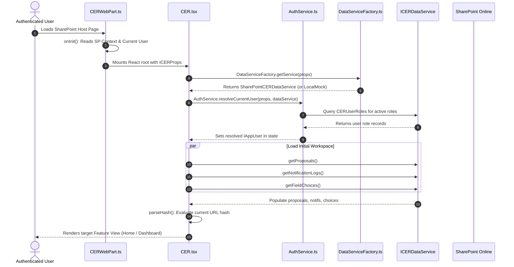

# CER Management System — Complete Project Specification & Technical Guide

**Organization:** Vedanta Limited / Cairn Oil & Gas  
**Application:** Capital Expenditure Request (CER) Management System  
**Target Site Collection:** `https://vedanta.sharepoint.com/sites/CERManagementSystemUAT`  
**Document:** `docs/PROJECT_DETAILS.md`  
**Version:** 3.0 (Enterprise Production Architecture)

---

## 1. Executive Summary & Business Objectives

The **Capital Expenditure Request (CER) Management System** is an enterprise-grade digital workflow platform built for **Vedanta Limited / Cairn Oil & Gas**. It automates, standardizes, and enforces governance over large capital investment proposals—such as new drilling machinery, oil & gas processing plant upgrades, pipeline infrastructure, and field equipment.

### Core Objectives:
1. **End-to-End Governance**: Replace paper/manual approval forms with an auditable, digital workflow integrated into Microsoft 365 SharePoint Online.
2. **SBU-Specific Multi-Tier Approval**: Route proposals dynamically across Strategic Business Units (SBUs)—**RJ North**, **RJ South**, **CBOS**, and **RAVA**—through sequential approval stages configured per SBU.
3. **Dynamic Project Owner Resolution**: Evaluate Project Owner approval stages dynamically per proposal without hardcoding or schema alterations.
4. **Strict Segregation of Duties (SoD)**: Systematically prevent proposal initiators and project owners from self-approving their own requests at operational approval stages.
5. **Indian Fiscal Year Phasing**: Automatically calculate and shift financial phasing labels across 3 fiscal periods aligned with the Indian Financial Year (April 1 to March 31).
6. **Native SharePoint Person Column Support**: Fully support SharePoint **Person or Group** columns via `ensureUser` and `<Field>Id` payload mapping (`UserId` in `CERUserRoles` and `cerOwnerId` in `CERProposals`), directly resolving Display Name, Email, and Login Identity from expanded Person objects.
7. **Comprehensive Audit & Reporting**: Maintain granular field-level audit logs, threaded discussion remarks, executive PDF generation, and multi-tab Excel data exports.

---

## 2. System Architecture & Technology Stack

### 2.1 Technology Stack
- **Framework**: SharePoint Framework (SPFx) v1.20.0
- **UI Library**: React 18.2.0 & React DOM 18.2.0
- **Language**: TypeScript 5.5+ (strict mode, 0 compilation errors)
- **Styling**: TailwindCSS 3.4+ & Vanilla CSS design tokens with full-bleed enterprise layout
- **Directory & Identity**: Entra ID / Microsoft 365 Directory People Picker with 1-character quick lookup and real-time M365 profile photo rendering via `UserAvatar.tsx`
- **Icons**: Lucide React 0.453+
- **Reporting & Export**: jsPDF 2.5.2, jspdf-autotable 3.8.4, SheetJS (XLSX) 0.18.5
- **Testing & Verification**: tsx (TypeScript Execute), Jest/Heft build rig

### 2.2 Dual-Engine Data Architecture
The application uses the **Factory Pattern** (`DataServiceFactory.ts`) to seamlessly switch between environments:
- **Production Mode (`SharePointCERDataService`)**: Connected to SharePoint Online REST APIs, supporting live lists, OData queries, batch operations, pagination, `ensureUser` resolution, and file library uploads.
- **Local Development & Testing Mode (`LocalMockCERDataService`)**: Provides an in-memory and `localStorage`-backed mock database seeded with realistic SBU hierarchies, sample CERs, and verified users for 100% offline development and instant automated test execution.

---

## 3. Application Lifecycle & Startup Sequence

When a user loads the SharePoint page hosting the CER web part, execution flows systematically through the following phases:



### URL Hash Navigation Matrix

The application implements client-side URL hash routing (`#view/proposalId`), enabling direct bookmarking, email deep linking, and full browser history integration:

| URL Hash | Target View Component | Required Role / Access |
|---|---|---|
| `#dashboard` | `Home/HomeView.tsx` | All authenticated users |
| `#create` | `CreateCER/CreateCERView.tsx` | Initiator or Admin role |
| `#change/{cerprno}` | `ChangeCER/ChangeCERView.tsx` | Proposal Owner, Initiator, or Admin |
| `#display/{cerprno}` | `DisplayCER/DisplayCERView.tsx` | All authenticated users |
| `#my-proposals` | `MyProposals/ProposalListView.tsx` (mode="my") | All authenticated users |
| `#all-proposals` | `MyProposals/ProposalListView.tsx` (mode="all") | All authenticated users |
| `#pending-approvals` | `PendingApprovals/PendingApprovalsView.tsx` | Approver or Admin role |
| `#approval-history` | `ApprovalWorkflow/ApprovalHistoryView.tsx` | All authenticated users |
| `#reports` | `Reports/ReportsView.tsx` | Finance, Audit, or Admin role |
| `#audit-trail` | `Audit/AuditTrailView.tsx` | All authenticated users |
| `#workflow-config` | `Admin/AdminConsoleView.tsx` | System Administrator only |

---

## 4. Clean Codebase & Directory Structure

```text
D:/Git/CER/
├── config/                                 # SPFx build, serve, and package configurations
│   ├── config.json
│   ├── package-solution.json
│   └── serve.json
│
├── docs/                                   # Authoritative project documentation (Only 2 docs)
│   ├── PROJECT_DETAILS.md                  # Master project requirements, architecture & guide
│   └── SHAREPOINT_LISTS_AND_COLUMNS_SETUP.md # Full 8-list schema specification & Person fields
│
├── src/
│   ├── webparts/
│   │   └── cer/
│   │       ├── CERWebPart.manifest.json    # SPFx web part manifest
│   │       ├── CERWebPart.ts               # SPFx WebPart lifecycle entry point & full-bleed setup
│   │       ├── declarations.d.ts           # CSS and asset module declarations
│   │       ├── tailwind.css                # TailwindCSS base styles
│   │       │
│   │       ├── components/                 # React UI Component Hierarchy
│   │       │   ├── CER.tsx                 # Master application controller, navigation & tab router
│   │       │   ├── ICERProps.ts            # WebPart props interface
│   │       │   │
│   │       │   ├── Admin/                  # Administrator Console
│   │       │   │   ├── AdminConsoleModal.tsx # Full-screen admin governance modal
│   │       │   │   ├── AdminOverviewTab.tsx  # Metrics & health overview
│   │       │   │   ├── ApprovalHierarchyTab.tsx # SBU sequential stage hierarchy editor (1..N)
│   │       │   │   ├── UserManagementTab.tsx # Enterprise RBAC assignment with 1-char lookup
│   │       │   │   ├── SystemSettingsTab.tsx # Indian FY phasing and system configuration
│   │       │   │   └── SystemAuditTab.tsx   # Security audit trail log viewer
│   │       │   │
│   │       │   ├── ApprovalWorkflow/       # Sequential Approval Workflow
│   │       │   │   ├── ApprovalDecisionModal.tsx # Sign-off & remarks submission dialog
│   │       │   │   ├── ApprovalHistoryView.tsx   # Chronological approval decision log
│   │       │   │   └── ApprovalProgressTracker.tsx # Interactive visual stepper with active stage badges
│   │       │   │
│   │       │   ├── Audit/                  # Field-level change log viewer
│   │       │   │   └── AuditTrailView.tsx  # Granular delta comparison table
│   │       │   │
│   │       │   ├── ChangeCER/              # Post-Rejection Proposal Revision
│   │       │   │   └── ChangeCERView.tsx   # Revision intake with automatic Level 1 reset
│   │       │   │
│   │       │   ├── Common/                 # Shared Reusable Components
│   │       │   │   └── UserAvatar.tsx      # Dynamic SharePoint/M365 profile photo & initials avatar
│   │       │   │
│   │       │   ├── CreateCER/              # Proposal Creation & Editing Intake Form
│   │       │   │   ├── CreateCERView.tsx           # Multi-section wizard container
│   │       │   │   ├── ProjectDetailsSection.tsx   # Section A: Header, Owner & SBU
│   │       │   │   ├── CostBreakdownSection.tsx    # Section B: Capital cost items & total
│   │       │   │   ├── BudgetJVSection.tsx         # Section C: Budget sanction & JV shares
│   │       │   │   ├── FinancialBenefitsSection.tsx# Section D: NPV, IRR, Payback quarters
│   │       │   │   ├── ExpenditurePhasingSection.tsx# Section E: 3-period Indian FY phasing
│   │       │   │   ├── AttachmentsSection.tsx      # Section F: Supporting files upload
│   │       │   │   ├── JustificationSection.tsx    # Section G: Narrative justification
│   │       │   │   └── DirectoryPeoplePicker.tsx   # 1-character enterprise directory search
│   │       │   │
│   │       │   ├── Dashboard/              # Interactive Executive Dashboard
│   │       │   │   └── DashboardView.tsx   # Executive metrics, charts, and KPI summary
│   │       │   │
│   │       │   ├── DisplayCER/             # Proposal Detailed View & Sign-Off
│   │       │   │   ├── DisplayCERView.tsx  # Full proposal inspection view
│   │       │   │   └── DecisionActionPanel.tsx # Approve / Reject / Re-evaluate controls
│   │       │   │
│   │       │   ├── Home/                   # Landing Experience & Navigation
│   │       │   │   └── HomeView.tsx        # Hero cards, quick actions, and recent activity
│   │       │   │
│   │       │   ├── MyProposals/            # Initiator Proposals Inbox
│   │       │   │   └── ProposalListView.tsx# Tabular listing with status filters & search
│   │       │   │
│   │       │   ├── Navigation/             # Shell Navigation
│   │       │   │   ├── AppHeader.tsx       # Top bar with current user profile card
│   │       │   │   └── TopNavbar.tsx       # Primary navigation tabs
│   │       │   │
│   │       │   ├── PendingApprovals/       # Approver Assigned Actions Inbox
│   │       │   │   └── PendingApprovalsView.tsx # Actionable cards for assigned stage approver
│   │       │   │
│   │       │   ├── Reports/                # Analytics & Multi-Format Data Export
│   │       │   │   └── ReportsView.tsx     # PDF and Excel generation center
│   │       │   │
│   │       │   ├── Shared/                 # Shared UI Utilities
│   │       │   │   └── DataTablePagination.tsx # Dynamic table pagination controller
│   │       │   │
│   │       │   └── UserManual/             # In-App User Guides & SOP Documentation
│   │       │       └── UserManualModal.tsx # Searchable user guide modal
│   │       │
│   │       ├── constants/                  # Configuration & Constant Tokens
│   │       │   └── index.ts                # SBU lists, currencies, default choices
│   │       │
│   │       ├── hooks/                      # Custom React Hooks & SharePoint Operations
│   │       │   ├── index.ts                # Clean hooks barrel export
│   │       │   ├── useSharePointOperations.ts # REST operations (GET, POST, MERGE, ensureUser)
│   │       │   └── useDynamicPagination.ts # Automatic viewport-aware pagination hook
│   │       │
│   │       ├── models/                     # Strong TypeScript Interfaces & Models
│   │       │   ├── AttachmentModel.ts      # ICERAttachment model
│   │       │   ├── AuditModel.ts           # ICERAuditRecord, ICERRemarkRecord models
│   │       │   ├── CERModel.ts             # ICERProposal, ICERCostBreakdown, Phasing models
│   │       │   ├── UserModel.ts            # IAppUser, IUserRoleAssignment, IDirectoryUser
│   │       │   ├── WorkflowModel.ts        # IWorkflowLevel, IApprovalDecision models
│   │       │   └── index.ts                # Models barrel export
│   │       │
│   │       ├── services/                   # Business Services & Data Abstractions
│   │       │   ├── index.ts                # Services barrel export
│   │       │   ├── ICERDataService.ts      # Master contract interface for all CRUD operations
│   │       │   ├── SharePointCERDataService.ts # Live SharePoint implementation
│   │       │   ├── LocalMockCERDataService.ts  # Local development & test mock service
│   │       │   ├── DataServiceFactory.ts   # Dynamic factory selector
│   │       │   ├── PersonFieldService.ts   # SharePoint Person field resolution & payload engine
│   │       │   ├── PermissionService.ts    # RBAC, SoD, and approval authorization checks
│   │       │   ├── AuthService.ts          # Current user session and group resolution
│   │       │   ├── PDFExportService.ts     # Client-side branded executive PDF generator
│   │       │   └── ExcelExportService.ts   # Multi-sheet spreadsheet export service
│   │       │
│   │       ├── utils/                      # Validation & Formatting Utilities
│   │       │   ├── attachmentValidation.ts # MIME type and size checks
│   │       │   ├── cerValidation.ts        # Mandatory field and financial totals validation
│   │       │   └── dateUtils.ts            # Date formatting and ISO conversions
│   │       │
│   │       └── tests/                      # Automated Verification & Test Suites (410 tests)
│   │           ├── CERBusinessLogic.test.ts      # Core lifecycle tests
│   │           ├── verifyAdminPerformance.ts    # Admin caching & single-flight tests (4 tests)
│   │           ├── verifyAllRequirements.ts     # Core business requirements tests (307 tests)
│   │           ├── verifyHomepageRefinement.ts  # Responsive design checks
│   │           ├── verifyIdentityColumnSchema.ts # Identity normalization & SoD tests (15 tests)
│   │           ├── verifyPersonFieldService.ts   # Person column & ensureUser tests (56 tests)
│   │           ├── verifySharePointOperations.ts # REST helper verification tests
│   │           └── verifySharePointPersistence.ts # Fail-closed persistence tests (28 tests)
│   │
│   └── tailwind.generated.css              # Compiled production Tailwind stylesheet
├── package.json                            # Scripts, dependencies, and project metadata
└── tsconfig.json                           # TypeScript compiler configuration
```

---

## 5. Business Rules & Governance Matrix

### 5.1 SBU-Specific Sequential Approval Engine
Each SBU maintains its own independent, configurable sequence of stages (`levelId = 1, 2, 3.. N`) managed directly in `CERWorkflowLevels`. Proposals follow strict contiguous stage progression (Level 1 → Level 2 → Level 3..) tailored to that SBU's operational requirements without any hardcoded corporate roles.

### 5.2 Dynamic Project Owner Resolution (`ProjectOwnerAuto`)
- In standard approval stages, approver identity is dynamically resolved from `CERUserRoles` matching `role = 'Approver'` and `approvalLevel = levelId`.
- When a stage has `assignmentType = 'ProjectOwnerAuto'` (or role title matches "Project Owner" / "Proposal Owner"):
  - The approver identity is **dynamically extracted** from the proposal's `cerOwner` Person field (or fallback `owname` / `owner_email`).
  - No static email is assigned in `CERWorkflowLevels`.
  - Proposals within the same SBU dynamically route to their respective project owners.

### 5.3 Segregation of Duties (SoD)
- **Initiator Exclusion**: An employee who creates a proposal or is designated as the CER Owner (`cerOwner` / `owner_email`) is **strictly forbidden** from approving that proposal at non-Project-Owner stages (e.g. Discipline Lead, SBU Head, etc.).
- If an initiator holds an `Approver` role at Level 2, the system automatically detects the conflict, disables the approve button, and displays:
  > *"Segregation of Duties Enforcement: You are the initiator/owner of this CER proposal and cannot approve your own request."*
- Administrators can intervene as governance auditors to advance proposals if an operational deadlock occurs.

### 5.4 Re-Approval on Revision Workflow
- If a proposal is rejected at any level (e.g. Level 3), the initiator can modify the proposal in **Change CER**.
- Saving the edited proposal automatically:
  1. Increments `revisionCount` by 1.
  2. Resets proposal status to `In Approval`.
  3. Resets `currentLevel` back to **Level 1** to ensure all approvers re-validate modified figures.
  4. Preserves all previous approval history in `CERApprovalDecisions` and remarks in `CERRemarksHistory`.

---

## 6. Indian Fiscal Year Dynamic Phasing Engine

The application implements automatic expenditure phasing based on the **Indian Fiscal Year (April 1 through March 31)**:

### Dynamic Label Generation:
1. **Prior Period (`phTillLabel`)**: `Till Mar'YY` (Cumulative capital spent before current fiscal year).
2. **Current FY (`phFyLabel`)**: `FY YY-ZZ` (Projected expenditure during active fiscal year).
3. **Beyond Period (`phBeyondLabel`)**: `Beyond FY'ZZ` (Expenditure in subsequent financial years).

### Fiscal Year Rollover Examples:
- **October 2026**:
  - `phTillLabel`: **Till Mar'26**
  - `phFyLabel`: **FY 26-27**
  - `phBeyondLabel`: **Beyond FY'27**
- **January 2027 – March 31, 2027** (Same Indian FY):
  - Retains **Till Mar'26 | FY 26-27 | Beyond FY'27**.
- **April 1, 2027** (FY Rollover Trigger):
  - Automatically advances to: **Till Mar'27 | FY 27-28 | Beyond FY'28** with zero manual intervention.

---

## 7. Directory People Picker & Person Field Architecture

### 7.1 `DirectoryPeoplePicker.tsx` & `UserAvatar.tsx`
- **1-Character Instant Lookup**: Typing a single character immediately triggers directory suggestions with a 150ms debounce.
- **Instant Focus Suggestions**: Clicking into the search input immediately surfaces active directory members.
- **Real-Time Photos**: Renders Microsoft 365 profile photos via `/_layouts/15/userphoto.aspx?size=M&accountname=${email}` with initials fallback badges.
- **Outside-Click Dismissal**: Clicking outside the input cleanly closes suggestions.

### 7.2 `PersonFieldService.ts` Engine
Provides complete, typed abstraction over SharePoint Person columns:
- **Identity Normalization**: Strips claims prefixes (`i:0#.f|membership|`) and trims emails.
- **REST User Resolution**: Calls `POST {siteUrl}/_api/web/ensureUser` to obtain site collection integer user IDs.
- **Site-Context Caching**: 10-minute in-memory cache keyed by `${siteUrl}::${normLogon}` to eliminate redundant network roundtrips.
- **Write Payload Formatting**: Formats single-person writes as `{ "UserId": 105 }` or `{ "cerOwnerId": 105 }` and multi-person writes as `{ "UsersId": { "results": [105, 202] } }`.
- **Response Extraction**: Normalizes expanded OData structures (`User/Id`, `User/Title`, `User/EMail`, `User/Name`) into typed `INormalizedPersonValue` objects.

---

## 8. Role-Based Access Control (RBAC) & Governance

The system enforces 4 enterprise roles:
1. **Initiator**:
   - Create new CER proposals across assigned SBUs.
   - Edit draft proposals and revise rejected proposals.
   - View personal submissions in "My Proposals".
2. **Approver**:
   - Access "Pending Approvals" inbox for assigned SBU and level.
   - Endorse (Approve) or Return with Remarks (Reject) proposals.
   - Enforced by Segregation of Duties checks.
3. **Admin**:
   - Manage SBU approval stages in Admin Console (`CERWorkflowLevels`).
   - Assign and revoke user roles (`CERUserRoles`).
   - Configure Indian FY phasing and system settings.
   - Full governance override to prevent approval deadlocks.
   - **Designated Bootstrap Admin**: `70007144@cairnindia.com` has automatic, guaranteed administrative access.
4. **Finance_Audit**:
   - Read-only access across all SBUs and proposals.
   - Access granular change logs (`CERAuditTrail`) and compliance reports.
   - Generate executive PDF briefs and export comprehensive Excel datasets.

---

## 9. Master 8 Lists & Naming Standards Reference

The application communicates exclusively with 8 lists in clean CamelCase (no underscores `_`):

| # | List / Library Name | Type | Purpose |
|---|---|---|---|
| 1 | **`CERProposals`** | Custom List | Master repository for all CER proposal records (Sections A through G). |
| 2 | **`CERAuditTrail`** | Custom List | Granular field-level delta change history for compliance and auditing. |
| 3 | **`CERRemarksHistory`** | Custom List | Threaded approval remarks and workflow discussion history. |
| 4 | **`CERWorkflowLevels`** | Custom List | SBU-specific approval hierarchies, role stages, and routing logic. |
| 5 | **`CERApprovalDecisions`** | Custom List | Formal sign-off records (Approved / Rejected) with timestamps. |
| 6 | **`CERAttachments`** | Document Library | Associated technical and financial PDF/Excel documentation. |
| 7 | **`CERNotifications`** | Custom List | Email notification dispatch records and recipient logs. |
| 8 | **`CERUserRoles`** | Custom List | Enterprise Role-Based Access Control (RBAC) registry. |

> For the complete schema specification, field types, and step-by-step manual creation instructions, refer to [SHAREPOINT_LISTS_AND_COLUMNS_SETUP.md](file:///d:/Git/CER/docs/SHAREPOINT_LISTS_AND_COLUMNS_SETUP.md).

---

## 10. Automated Verification & Testing Commands

The project includes 410 automated tests covering all business rules, workflows, persistence, and schema integrity:

```bash
# 1. Run Person Column & ensureUser tests (56 tests)
npm run test:person-fields

# 2. Run Identity Schema & SoD tests (15 tests)
npm run test:identity-schema

# 3. Run Core Business Logic & Approval Workflow tests (307 tests)
npm run test:requirements

# 4. Run Admin Console Performance & Single-Flight tests (4 tests)
npm run test:admin-perf

# 5. Run SharePoint Persistence Defect Regression tests (28 tests)
npm run test:persistence

# 6. Verify Full TypeScript Static Compilation (0 errors)
npx tsc --noEmit
```

### Verification Results Summary:
- **TypeScript Compiler (`tsc`)**: 0 errors across all source files.
- **Automated Tests**: **410 Passed | 0 Failed (100% Pass Rate)**.
