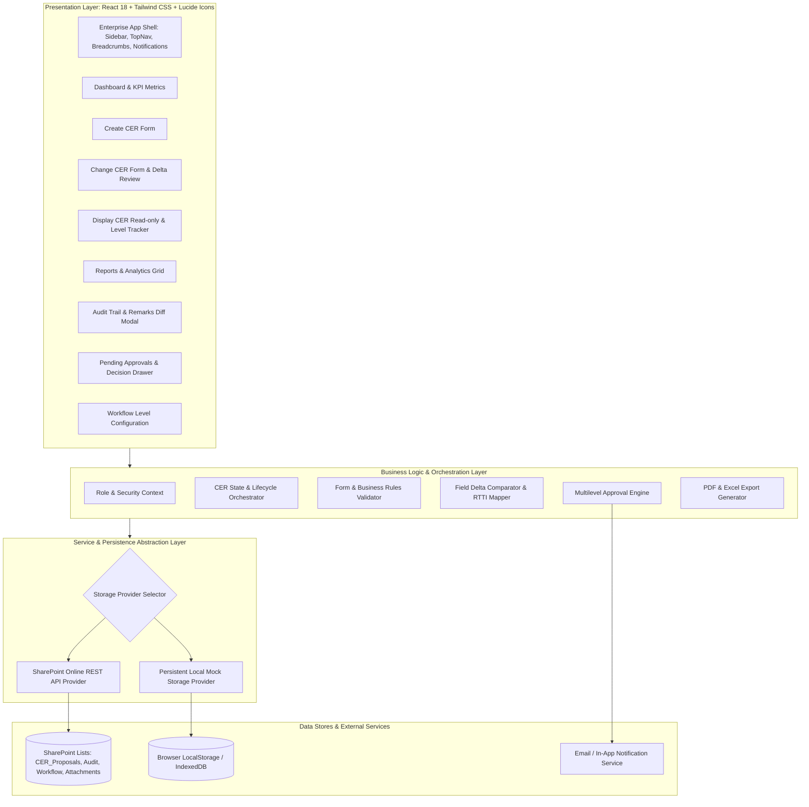

# SPX — Capital Expenditure Request Management System (CER)
## Technical Architecture Specification

### 1. Architectural Overview & Design Principles

The SPX CER Management System is engineered as an enterprise Single-Page Application (SPA) designed to run both as a modern Microsoft SharePoint Framework (SPFx 1.24) Client-Side Web Part inside Microsoft 365 / SharePoint Online (`https://vedanta.sharepoint.com/sites/CERManagementSystem`) and in a self-contained local developer workbench.

---

### 2. Layered Architecture Details

#### 2.1 Presentation Layer
- **Framework**: React 18 with TypeScript.
- **Styling**: Tailwind CSS with custom enterprise design tokens (soft slate backgrounds, crisp white card surfaces, deep charcoal typography `#1e293b`, corporate navy primary `#0f172a`, restrained indigo accent `#3b82f6`, muted success green `#10b981`, amber warning `#f59e0b`, crimson error `#ef4444`).
- **Icons**: Lucide React icons for consistent, clean vector aesthetics (no emojis).
- **Component Design System**:
  - `StatCard`: KPI display with trends, icons, and status indicators.
  - `DataTable`: Generic sortable, filterable, paginated enterprise table.
  - `FormSection`: Collapsible and cleanly grouped form containers.
  - `StatusBadge`: Consistent color-coded status badges for CER status and approval levels.
  - `Modal` / `Drawer`: Clean popups for long remarks, approval actions, and confirmation dialogs.
  - `WordCounter`: Real-time feedback for the 350–400 word remarks limitation.

#### 2.2 Business Logic & Validation Engine
- **Field Validation**:
  - Enforces mandatory fields: Project Name, CER Owner, Amount, Category, Start Date, Completion Date, Phasing buckets, Cost breakdown items.
  - Numeric validations: Amount > 0; Total cost matches sum of components (`ENGINEER + S_FAC + COMIS + PREOP + OTHERS == TOTAL`).
  - Dates validation: `COM_DATE >= ST_DATE`; Duration auto-calculated in months/days.
  - Remarks validation: 350–400 word threshold warning.
- **Delta & Audit Engine**:
  - Performs dynamic deep-object diffing between prior and revised proposals.
  - Excludes system metadata (`CREATED_DATE`, `CREATED_BY`, `MODIFIED_DATE`, `USRID`, `CHANGE_IND`).
  - Maps SAP-inherited short keys (`PROD`, `CAPEX`, `OPEX`, `_23`, `_B`) to clear business labels.
- **Approval Workflow Engine**:
  - Configurable sequence of levels (e.g., L1: Project Manager, L2: Finance Head, L3: VP / Business Head, L4: Managing Director).
  - Evaluates proposal state transitions (`Draft` → `Pending Approval L1` → `Pending Approval L2` → ... → `Approved` or `Rejected` or `Revised`).
  - Generates immutable decision records.

#### 2.3 Persistence Abstraction Layer
- The system defines a unified interface `ICERDataService`.
- Two concrete implementations:
  1. `SharePointCERDataService`: Uses `SPHttpClient` to interact with SharePoint Online lists (`CER_Proposals`, `CER_AuditTrail`, `CER_RemarksHistory`, `CER_WorkflowConfig`, `CER_ApprovalDecisions`, `CER_Attachments`).
  2. `LocalMockCERDataService`: Uses browser storage pre-seeded with realistic Cairn / Vedanta CER data for offline development, automated testing, and workbench demonstration.
- Automatic runtime detection: If running inside a live SharePoint site with valid `spHttpClient`, it connects to SharePoint Online; otherwise, it seamlessly falls back to the mock persistence store with zero configuration needed.

---

### 3. Document Generation Architecture

#### 3.1 PDF Document Engine (FR-09)
- Client-side vector PDF generation using `jspdf` and `jspdf-autotable`.
- Standard corporate CER document header (SPX / Vedanta branding, Proposal ID, Timestamp).
- Structured tabular sections: Project Summary, Financial Benefits, Phasing Matrix, Cost Breakdown, Approval Trail, and Business Justification.
- Generates file naming format: `<CERPRNO>_<YYYYMMDD>_<HHMMSS>.pdf`.

#### 3.2 Excel Export Engine (FR-10)
- Generates standard `.xlsx` / spreadsheet-compatible outputs using `xlsx`.
- Business-friendly column headers: "Amount of CER", "Payback / Non-Payback", "Financial Benefits - NPV ($mm)", "Corporate Budget Amount", etc.
- Built-in Formula Injection Protection: Sanitizes any text string starting with `=`, `+`, `-`, `@` by prepending a single quote `'`.

---

### 4. Security & Role-Based Access Control (RBAC)
- Role definitions:
  - `Initiator`: Can create, edit own drafts, revise approved proposals.
  - `Approver`: Can view assigned pending tasks, approve/reject with comments.
  - `Finance_Audit`: Full read-only access to all proposals, audit trail, reports, and exports.
  - `Admin`: Can modify workflow levels and system settings.
- Role switcher provided in header for development/demo testing across all roles.
